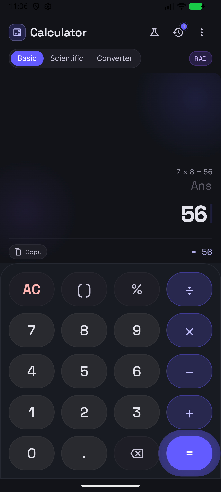
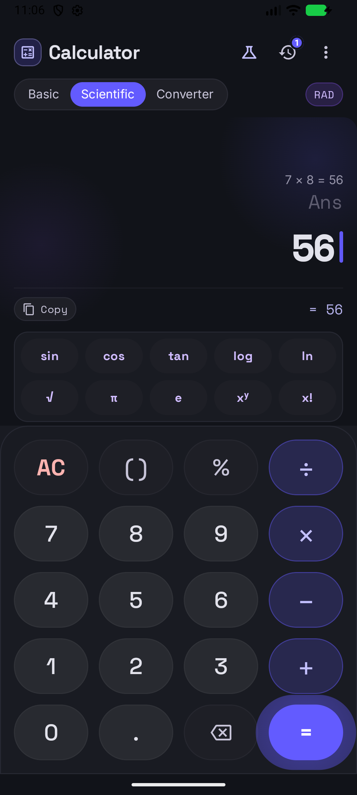
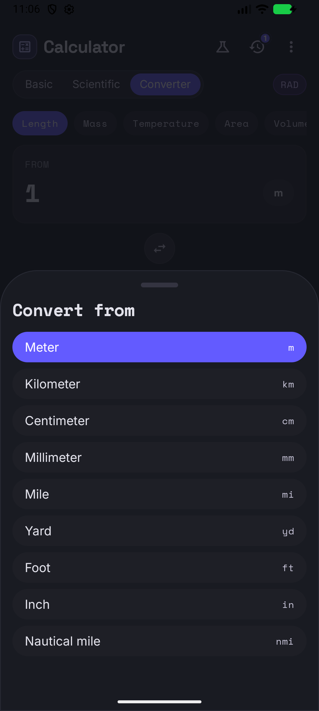
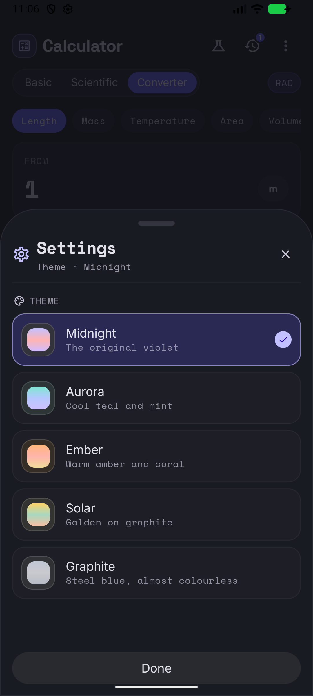
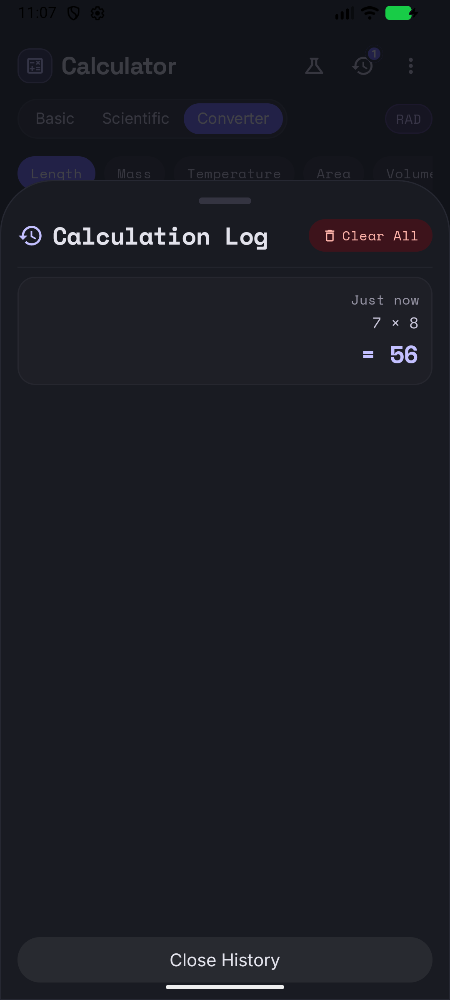

# Aether Calculator

A calculator for Android and desktop, written once in Kotlin Multiplatform with Compose
Multiplatform. The interface follows the design in [`DESIGN.md`](DESIGN.md) and
[`code.html`](code.html) — a dark, monospaced reading canvas above a pill-shaped keypad.

| | | |
|---|---|---|
|  |  |  |
| **Basic** — live audit trail, primary readout and a copy row | **Scientific** — the function matrix unfolds below the canvas | **Converter** — length, mass, temperature, area and volume |

| | |
|---|---|
|  |  |
| **Five themes** — picked in Settings, cross-faded across the whole app | **Calculation log** — survives minimising the app, cleared by hand or by a fresh start |

## Features

- **Basic, scientific and converter** modes with the transitions between them.
- **A real expression engine** — precedence, parentheses, percentages, factorials, roots,
  powers, `sin`/`cos`/`tan` in degrees or radians, and `Ans` for the previous answer.
- **A calculation log** that names the function behind every value (`sin(30) = 0.5`,
  `√(9) = 3`, `5! = 120`) and can be reloaded with one tap.
- **A unit converter** with ten unit families, a live result and a swap button that turns
  as it is pressed.
- **Five themes** — Midnight, Aurora, Ember, Solar and Graphite — chosen in Settings. The
  whole app cross-fades into the new colours and the choice is remembered.
- **Tactile keys** that compress under the thumb and spring back.
- **One codebase, two platforms**: the same composables run on Android and on the desktop.

## Download

The installable APK is attached to the [Releases](../../releases) page of this repository.

```bash
# install the latest release over an existing install
adb install -r AetherCalculator-1.0.6-release.apk
```

The release APK is signed with the standard Android debug key, so it installs directly.
Swap in a real upload key before publishing to a store.

## Built with

| | |
|---|---|
| Kotlin | 2.1.21 (Multiplatform) |
| Compose Multiplatform | 1.8.2 |
| Android Gradle Plugin | 8.10.1 |
| Gradle | 8.14.3 |
| JDK | 17 |
| Android | minSdk 24, target/compile SDK 36 |

## Project layout

```
shared/          the whole app: UI, engine and theme, in commonMain
  ui/            the calculator, the converter, the sheets and the menu
  core/          the expression engine, units and number formatting
  ui/theme/      the palettes, the type scale and the shapes
androidApp/      the Android entry point
desktopApp/      the Compose Desktop entry point
tools/           helpers for driving the desktop build during testing
docs/            the screenshots used in this file
```

The shared module holds no platform-specific code: persistence is done through a small
`ThemeStore` interface in `commonMain` that each app module implements, so there is not a
single `expect`/`actual` pair in the project.

## Building it

```bash
# Android — the release APK lands in androidApp/build/outputs/apk/release
./gradlew :androidApp:assembleRelease

# Desktop
./gradlew :desktopApp:run

# The shared tests
./gradlew :shared:test
```

## Design

The interface is built from the artifacts in this repository: [`DESIGN.md`](DESIGN.md)
describes the type scale, the spacing and the components, [`code.html`](code.html) is the
working prototype, and [`screen.png`](screen.png) is the reference screen. The design
system is Material You shaped — pill keys, stadium segments and soft-curved cards — with
`Space Mono` for the readouts and `Space Grotesk` for the key caps.
